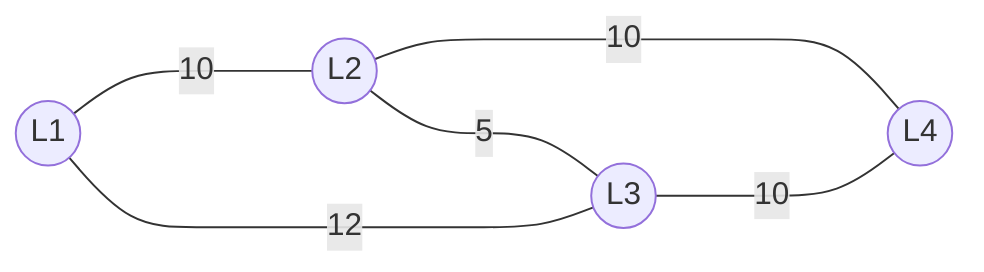
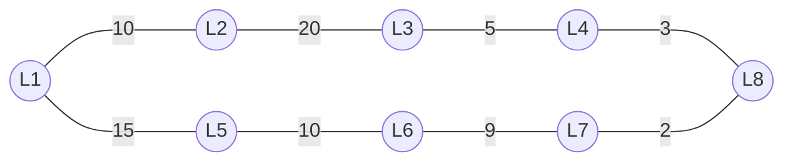
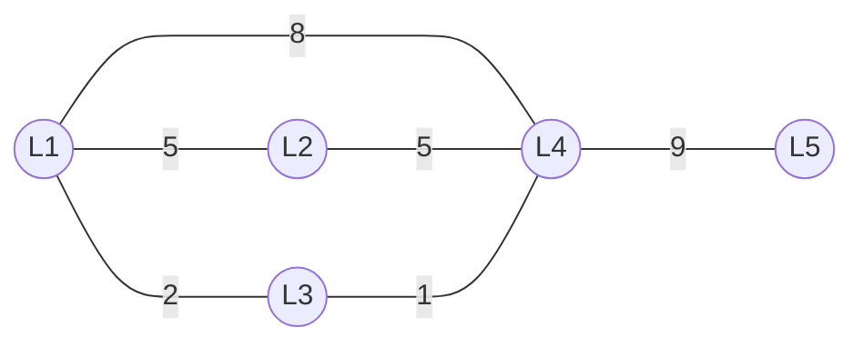
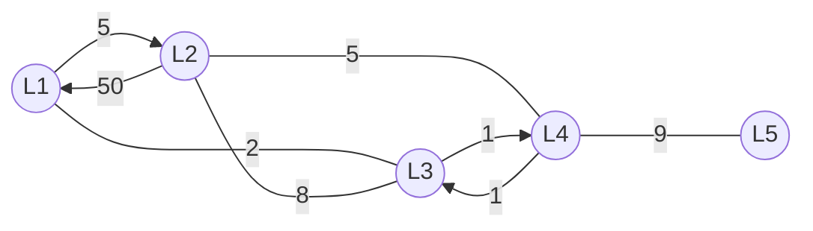
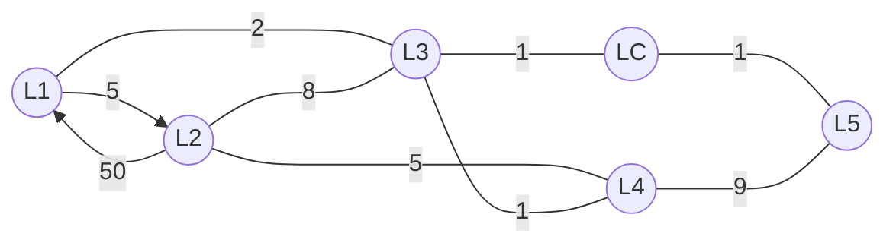
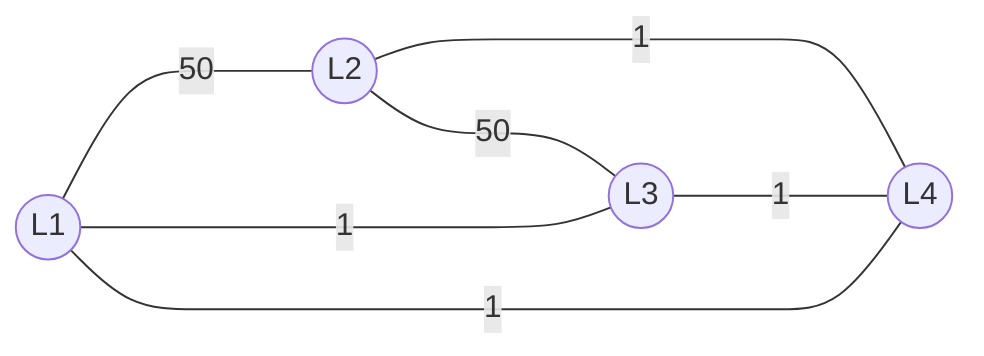
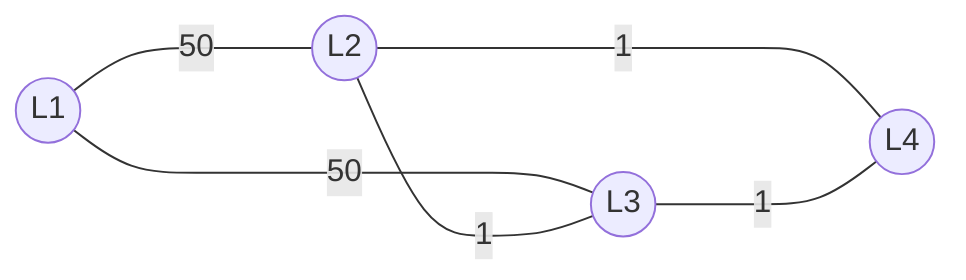
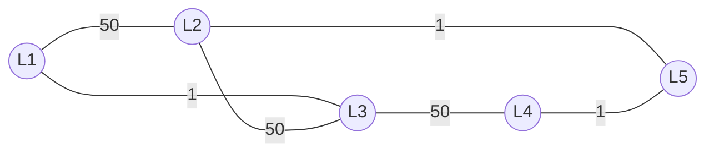
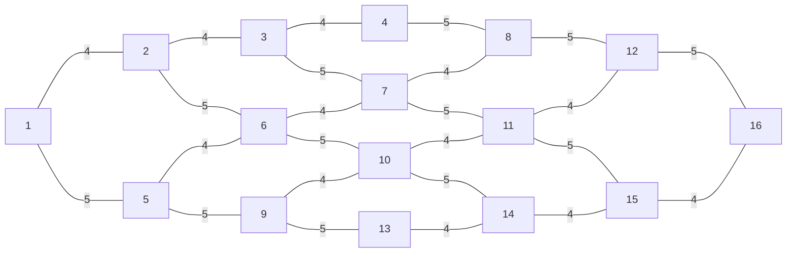
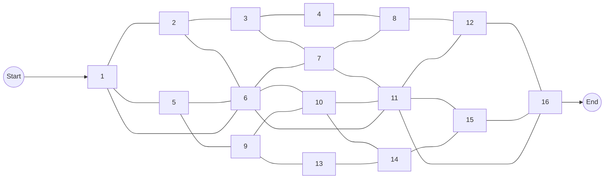

**Overview**
This document mirrors the "test_opp" sheet in [tests/opp_v2/Test cases.xlsx](tests/opp_v2/Test%20cases.xlsx). Graph references in the table map to the Graph Catalog below; only rows marked "Ver Grafo" in the sheet receive a graph. Text is ASCII-transliterated from the original.

**Graph Catalog**
Graph G1 (IDs: 1)

Graph G2 (IDs: 2.1, 2.2, 2.3)

Graph G3 (IDs: 3)

Graph G4 (IDs: 4)

Graph G5 (IDs: 5)

Graph G6 (IDs: 6)

Graph G7 (IDs: 7)

Graph G8 (IDs: 8)

Graph G9 (IDs: 9, 10, 11, 15)

Graph G10 (IDs: 16)

**Test Cases**
| ID | Name | Key | Description | Orders | Locations | Missions | Pickers | Periods | Expected | Obtained | Status | Time | Notes | Graph |
| --- | --- | --- | --- | --- | --- | --- | --- | --- | --- | --- | --- | --- | --- | --- |
| 1 | test_basic_two_orders_capacity_limit | Basico | Testeo de funcionalidad basica con grafo simple. | 2 | 4 | 2 | 2 | 1 | Feassible | Feassible | Pass | - | - | G1 |
| 2.1 | test_two_orders_two_aisles | Basico | Las ordenes definen el camino de cada picker. | 2 | 8 | 2 | 2 | 2 | Feasible | Feasible | Pass | - | - | G2 |
| 2.2 | test_two_orders_two_aisles_one_picking_point_per_order | Locacion ordenes | Cada orden tiene una locacion asignada. | 2 | 8 | 2 | 2 | 2 | Feasible | Feasible | Pass | - | - | G2 |
| 2.3 | test_two_orders_two_aisles_using_one_aisle | Locacion ordenes | Las ordenes comparten un mismo pasillo. | 2 | 8 | 2 | 2 | 2 | Feasible - Grafo esperado | Feasible | Pass | - | - | G2 |
| 3 | test_two_possible_routes | Camino | El modelo debe elegir entre dos caminos posibles. | 2 | 5 | 2 | 2 | 1 | Feasible | Feasible | Pass | - | - | G3 |
| 4 | test_repeated_picking_locations | Camino - ciclo | Las ordenes fuerzan a que los recorridos generen un ciclo. | 2 | 5 | 1 | 2 | 1 | Infeasible (ver grafo "esperado" --> contiene ciclos) | Infeasible | Pass | - | El modelo no permite caminos con ciclos. | G4 |
| 5 | test_repeated_picking_locations_2 | Camino - ciclo | Se agrega un vertice "Comodin" al test numero 4, con el fin de evitar el ciclo. | 3 | 6 | 1 | 2 | 1 | Feasible - Grafo esperado | Feasible | Pass | - | Se comprueba que el test anterior resulta infeasible debido al ciclo generado | G5 |
| 6 | test_two_orders_two_locations | Locacion ordenes | Hay dos ordenes, ambas de la misma mision, que deben visitar dos locaciones distintas. Los caminos del grafo que no pasan por las locaciones requeridas tienen un peso menor. | 2 | 4 | 1 | 1 | 1 | Feasible - Grafo esperado | Feasible | Pass | - | Se elige el camino que pasa por ambas locaciones requeridas, a pesar de que la suma de los pesos de los arcos elegidos es mayor a otras posibilidades que no cumplen con las locaciones. | G6 |
| 7 | test_two_orders_two_locations_two_missions | Locacion ordenes | Hay dos ordenes, cada una en una mision diferente, que deben visitar tres locaciones distintas | 2 | 4 | 2 | 1 | 1 | Feasible - Grafo esperado | Feasible | Pass | - | Cada mision respeta las ordenes asignadas. | G7 |
| 8 | test_four_orders_two_locations_two_missions | Locacion ordenes | Hay cuatro ordenes, dos por mision, que deben visitar tres locaciones distintas | 4 | 5 | 2 | 1 | 1 | Feasible - Grafo esperado | Feasible | Pass | - | Cada mision respeta las ordenes asignadas. | G8 |
| 9 | test_twelve_orders_six_missions_three_pickers_one_order_per_vehicle | Evaluacion de tiempos | Cada picker tiene dos misiones y dos periodos. Cada mision tiene 2 ordenes. | 12 | 4x4 | 6 | 3 | 2 | Feasible | Feasible | Pass | Menos de un segundo | - | G9 |
| 10 | test_two_periods_two_orders_per_vehicle | Evaluacion de tiempos | Como el anterior, pero en cada vehiculo entran dos ordenes a la vez | 12 | 4x4 | 6 | 3 | 2 | Fesible | Feasible | Pass | Menos de un segundo | Misma solucion al test anterior, debido a los dos periodos (no se llena el vehiculo). | G9 |
| 11 | test_one_period_two_orders_per_vehicle | Evaluacion de tiempos | Como el anterior, pero cada picker tiene solo un periodo. | 12 | 4x4 | 6 | 3 | 1 | Fesible | Feasible | Pass | Menos de un segundo | El resultado de la funcion objetivo es menos de la mitad al del test anterior. | G9 |
| 12 | test_100_locations | Estres | Similar al test 9 | 12 | 10x10 | 6 | 3 | 1 | Feasible | Feasible | Pass | 4 segundos | - | - |
| 13 | test_400_locations | Estres | Similar al test 9 | 12 | 20x20 | 6 | 3 | 1 | Feasible | Feasible | Pass | 100 segundos (1.6 minutos) | - | - |
| 14 | test_625_locations | Estres | Similar al test 9 | 12 | 25x25 | 6 | 3 | 1 | Feasible | Feasible | Pass | 320 segundos (5.3 minutos) | - | - |
| 15 | - | Camino | Un picker, una mision. Se debe encontrar el mejor camino. Grafo grilla. Ordenes que pasan por mas de una locacion. | 3 | 4x4 | 1 | 1 | 1 | Feasible - Grafo esperado | Infeasible | AssertionError | Menos de un segundo | Si se requiere visitar una misma locacion en dos ordenes, el modelo retorna infeasible, (creo que) por la constraint constraint_one_input_arc_per_node. Deberia ingresar al pasillo y recoger todo, no salir y luego querer entrar otra vez. | G9 |
| 16 | - | Camino - ciclo | Dos pickers, tres misiones. Grafo grillacon pasillos transversales. Ordenes que pasan por mas de una locacion. | 6 | 4x4 | 3 | 2 | 2 | Feasible - Grafo esperado | Infeasible | AssertionError | - | - | G10 |
| 16 | - | Camino - ciclo | Un picker, una mision.  Grafo grilla con pasillos transversales. Ordenes que pasasn por mas de una locaciion. Se debe encontrar el mejor camino. | 3 | 4x4 | 1 | 1 | 1 | Feasible - Grafo esperado | Infeasible | Pendiente | - | - | - |
| 17 | - | Camino - ciclo | Cada picker tiene dos misiones, cada una con cinco ordenes. Solapamiento de pasillos. | 10 | 4x4 | 4 | 2 | 3 | - | - | Pendiente | - | - | - |
