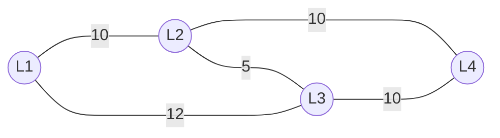
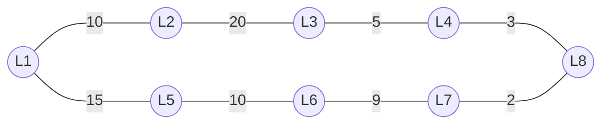
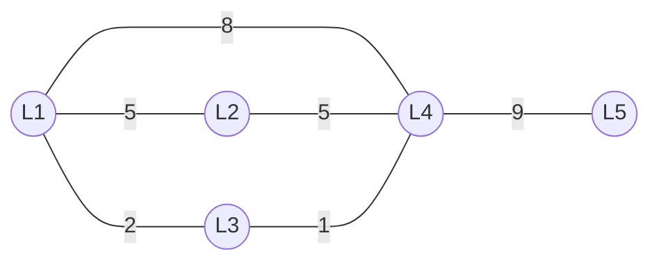
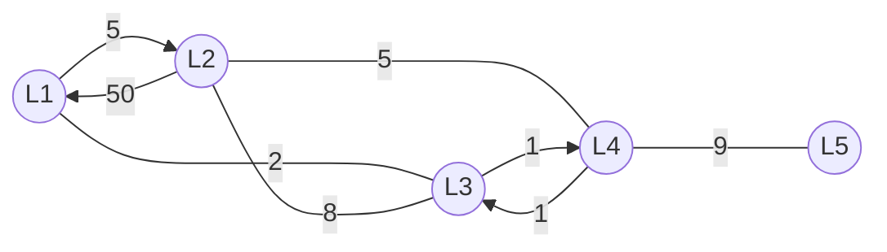
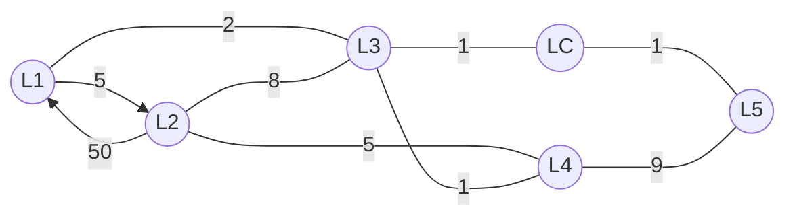
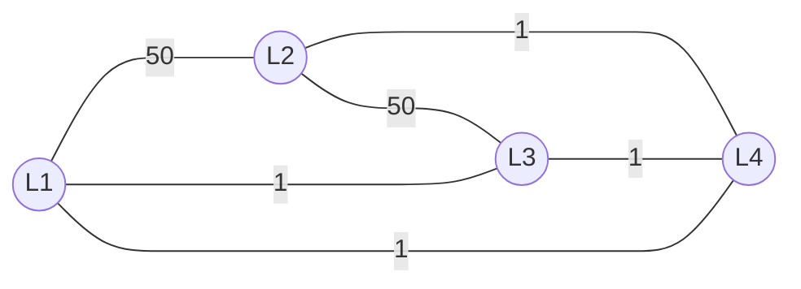
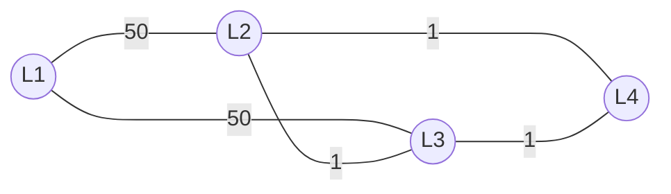
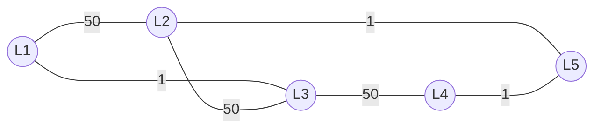
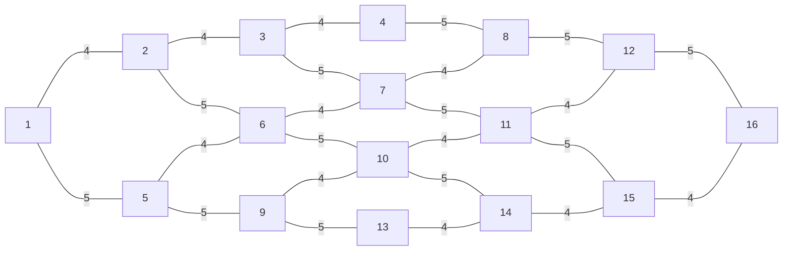
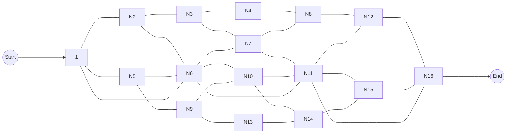

**Overview**
This document mirrors the "test_opp_v2" sheet in [tests/opp_v2/Test cases.xlsx](tests/opp_v2/Test%20cases.xlsx). Graph references in the table map to the Graph Catalog below; only rows marked "Ver Grafo" in the sheet receive a graph. Text is ASCII-transliterated from the original.

**Graph Catalog**
Graph G1 (IDs: 1)

Graph G2 (IDs: 2.1, 2.2, 2.3)

Graph G3 (IDs: 3)

Graph G4 (IDs: 4)

Graph G5 (IDs: 5)

Graph G6 (IDs: 6)

Graph G7 (IDs: 7)

Graph G8 (IDs: 8)

Graph G9 (IDs: 9, 10, 11, 15)

Graph G10 (IDs: 16)

**Test Cases**
| ID | Name | Key | Description | Orders | Locations | Lots | Pickers | LotsFeasible | Expected | Obtained | Status | Time | Notes | Graph |
| --- | --- | --- | --- | --- | --- | --- | --- | --- | --- | --- | --- | --- | --- | --- |
| 1 | test_basic_two_orders_capacity_limit | Basico | Testeo de funcionalidad basica con grafo simple. | 2 | 4 | 2 | 2 | 0 | Feassible | Feassible | Pass | - | - | G1 |
| 2.1 | test_two_orders_two_aisles | Basico | Las ordenes definen el camino de cada picker. | 2 | 8 | 2 | 2 | 0 | Feasible | Feasible | Pass | - | - | G2 |
| 2.2 | test_two_orders_two_aisles_one_picking_point_per_order | Locacion ordenes | Cada orden tiene una locacion asignada. | 2 | 8 | 2 | 2 | 0 | Feasible | Feasible | Pass | - | - | G2 |
| 2.3 | test_two_orders_two_aisles_using_one_aisle | Locacion ordenes | Las ordenes comparten un mismo pasillo. | 2 | 8 | 2 | 2 | 0 | Feasible - Grafo esperado | Feasible | Pass | - | - | G2 |
| 3 | test_two_possible_routes | Camino | El modelo debe elegir entre dos caminos posibles. | 2 | 5 | 2 | 2 | 0 | Feasible | Feasible | Pass | - | - | G3 |
| 4 | test_repeated_picking_locations | Camino - ciclo | Las ordenes fuerzan a que los recorridos generen un ciclo. | 2 | 5 | 1 | 2 | 0 | Infeasible (ver grafo "esperado" --> contiene ciclos) | Infeasible | Pass | - | El modelo no permite caminos con ciclos. | G4 |
| 5 | test_repeated_picking_locations_2 | Camino - ciclo | Se agrega un vertice "Comodin" al test numero 4, con el fin de evitar el ciclo. | 3 | 6 | 1 | 2 | 0 | Feasible - Grafo esperado | Feasible | Pass | - | Solucionado | G5 |
| 6 | test_two_orders_two_locations | Locacion ordenes | Hay dos ordenes, ambas de la mismo lote, que deben visitar dos locaciones distintas. Los caminos del grafo que no pasan por las locaciones requeridas tienen un peso menor. | 2 | 4 | 1 | 1 | 0 | Feasible - Grafo esperado | Feasible | Pass | - | Solucionado | G6 |
| 7 | test_two_orders_two_locations_two_missions | Locacion ordenes | Hay dos ordenes, cada una en un lote diferente, que deben visitar tres locaciones distintas | 2 | 4 | 2 | 1 | 0 | Feasible - Grafo esperado | Feasible | Pass | - | Cada mision respeta las ordenes asignadas. | G7 |
| 8 | test_four_orders_two_locations_two_missions | Locacion ordenes | Hay cuatro ordenes, dos por lote, que deben visitar tres locaciones distintas | 4 | 5 | 2 | 1 | 0 | Feasible - Grafo esperado | Feasible | Pass | - | Cada mision respeta las ordenes asignadas. | G8 |
| 9 | test_twelve_orders_six_missions_three_pickers_one_order_per_vehicle | Evaluacion de tiempos | Cada picker tiene dos lotes. Cada lote tiene 2 ordenes. No entra en el carrito. | 12 | 4x4 | 6 | 3 | 0 | Ineasible (no entra en el carrito) | Infeasible | Pass | Menos de un segundo | - | G9 |
| 10 | test_two_periods_two_orders_per_vehicle | Evaluacion de tiempos | Como el anterior, pero en cada vehiculo entran dos ordenes a la vez | 12 | 4x4 | 6 | 3 | 0 | Fesible | Feasible | Pass | Menos de un segundo | Misma solucion al test anterior, debido a los dos periodos (no se llena el vehiculo). | G9 |
| 11 | test_one_period_two_orders_per_vehicle | Evaluacion de tiempos | Como el anterior, pero cada picker tiene solo un periodo. | 12 | 4x4 | 6 | 3 | 0 | Fesible | Feasible | Pass | Menos de un segundo | El resultado de la funcion objetivo es menos de la mitad al del test anterior. | G9 |
| 12 | test_100_locations | Estres | Similar al test 9 | 12 | 10x10 | 6 | 3 | 0 | Feasible | Feasible | Pass | 4 segundos | - | - |
| 13 | test_400_locations | Estres | Similar al test 9 | 12 | 20x20 | 6 | 3 | 0 | Feasible | Feasible | Pass | 100 segundos (1.6 minutos) | - | - |
| 14 | test_625_locations | Estres | Similar al test 9 | 12 | 25x25 | 6 | 3 | 0 | Feasible | Feasible | Pass | 320 segundos (5.3 minutos) | - | - |
| 15 | test_3_orders_1_mission_1_picker | Camino | Un picker, un lote. Se debe encontrar el mejor camino. Grafo grilla. Ordenes que pasan por mas de una locacion. | 3 | 4x4 | 1 | 1 | 0 | Feasible - Grafo esperado | Infeasible | Pass | Menos de un segundo | - | G9 |
| 16 | test_3_orders_1_mission_1_picker | Camino - ciclo | Dos pickers, tres lotes. Grafo grilla con pasillos transversales. Ordenes que pasan por mas de una locacion. | 6 | 4x4 | 3 | 2 | 0 | Feasible - Grafo esperado | Infeasible | Pass | - | - | G10 |
| 16 | test_6_orders_3_missions_2_pickers | Camino - ciclo | Un picker, un lote.  Grafo grilla con pasillos transversales. Ordenes que pasasn por mas de una locacion. Se debe encontrar el mejor camino. | 3 | 4x4 | 1 | 1 | 0 | Feasible - Grafo esperado | Infeasible | - | - | - | - |
| 17 | test_branched_single_mission_route | Camino - ciclo | Grafo con ciclos. Cuatro locaciones requeridas. | 4 | 7 | 1 | 1 | 0 | Feasible - Grafo esperado | Feasible - Grafo esperado | Pass | - | - | - |
| 18 | test_detour_single_mission_route | Camino | Grafo con ciclos grandes. Cuatro locaciones requeridas. Camino largo. | 5 | 8 | 1 | 1 | 1 | Feasible - Grafo esperado | Feasible - Grafo esperado | Pass | - | - | - |
| 19.1 | test_longer_single_mission_route | Camino | Grafo lineal con "ramas" que generan ciclos. | 6 | 9 | 1 | 1 | 1 | Feasible - Grafo esperado | Feasible - Grafo esperado | Pass | - | - | - |
| 19.2 | test_longer_single_mission_penalties | Tardanza por due_date | Grafo lineal con "ramas" que generan ciclos. Comparacion de dos ejecuciones, una con due_date mas cercana que otra, por lo que la de due_date mas cercana (total_tardiness_low) tiene mayor tardanza. | 6 | 9 | 1 | 1 | 1 | Feasible total_tardiness_low > 0, total_tardiness_high ~= 0 | Feasible total_tardiness_low > 0, total_tardiness_high ~= 0 | - | - | - | - |
| 19.3 | test_longer_single_mission_duplicate_location_infeasible | infeasible por locacion | En un mismo lote, dos ordenes requieren pasar por la misma locacion. | 6 | 9 | 1 | 1 | 0 | Infeasible??? | Infeasible | Pass | - | - | - |
| 20.1 | test_grid_multi_location_orders | Locacion ordenes | Diversas locaciones a visitar | 12 | 5x3 | 4 | 2 | 4 | Feasible | Feasible | Pass | - | - | - |
| 20.2 | test_grid_penalties_due_date | Tardanza por due_date | Comparacion de dos ejecuciones, una con due_date mas cercana que otra, por lo que la de due_date mas cercana (total_tardiness_low) tiene mayor tardanza. | 12 | 5x3 | 4 | 2 | 4 | Feasible total_tardiness_low > 0, total_tardiness_high ~= 0 | Feasible total_tardiness_low > 0, total_tardiness_high ~= 0 | Pass | - | - | - |
| 20.3 | test_grid_penalties_order_size | Tardanza por cap_n | Comparacion de dos ejecuciones, una con cap_n mas baja (caso total_tardiness_small) que otra, por lo que la de cap_n menor tiene menos tardanza. | 12 | 5x3 | 4 | 2 | 4 | Feasible total_tardiness_small < total_tardiness_large | Feasible total_tardiness_small < total_tardiness_large | Pass | - | - | - |
| 20.4 | test_grid_shared_locations_across_batches | Locacion ordenes | Lotes con locaciones compartidas. | 12 | 5x3 | 4 | 2 | 4 | Feasible | Feasible | Pass | - | - | - |
| 20.5 | test_grid_duplicate_location_within_batch_infeasible | infeasible por locacion | En un mismo lote, dos ordenes requieren pasar por la misma locacion. | 12 | 5x3 | 4 | 2 | 4 | Infeasible??? | Infeasible | Pass | - | - | - |
| 20.6 | test_grid_infeasible_capacity | Infeasible por cap_vehicle | Capacidad del vehiculo demasiado baja para los lotes. | 12 | 5x3 | 4 | 2 | 4 | Feasible | Feasible | Pass | - | - | - |
| 21.1 | test_bridge_shared_locations_across_batches | Locacion ordenes | Grafo con "puentes". Al menos dos lotes comparten locaciones. | 12 | 12 | 4 | 2 | 4 | Feasible | - | Pass | - | - | - |
| 21.2 | test_bridge_tardiness_beta_picking | Tardanza por beta_picking | Con due_date fijo, aumenta beta_picking (total_tardiness_slow) para incrementar la tardanza total del batch (mas tiempo de picking  mas tardanza). | 12 | 12 | 4 | 2 | 4 | Feasible total_tardiness_slow > total_tardiness_fast | Feasible total_tardiness_slow > total_tardiness_fast | Pass | - | - | - |
| 21.3 | test_bridge_earliness_order_size | Earliness por cap_n | Aisla la earliness bajando la tardanza (due_date grande). Con cap_n chico (caso total_earliness_small), earliness grande; con cap_n grande (caso total_earliness_large), earliness menor. | 12 | 12 | 4 | 2 | 4 | Feasible total_earliness_small > total_earliness_large |  total_earliness_small = 0, total_earliness_large = 0 | AssertionError | - | - | - |
| 21.4 | test_bridge_disconnected_required_location | Infeasible por desconexion | Grafo desconectado con locacion desconectada requerida. | 12 | 12 | 4 | 2 | 4 | Infeasible | Infeasible | Pass | - | - | - |
| 22 | test_earliness_when_batch_finishes_before_due_date | Adelanto por due_Date y peso | Un picker, un lote, una orden. due_date alto y adelanto con mucho peso. Por lo tanto, deberia haber penalidad por adelanto, y no por tardanza. | 1 | 4x4 | 1 | 1 | 1 | Feasible; ea > 0; ta = 0 | Feasible; ea > 0; ta = 1 | Pass | - | - | - |
| 23 | test_tardiness_when_batch_finishes_after_due_date | Tardanza por peso | Un picker, un lote, una orden. due_date 0 y tardanza con mucho peso. Por lo tanto, deberia haber penalidad por tardanza, y no por adelanto. | 1 | 4x4 | 1 | 1 | 1 | Feasible; ea = 0; ta > 0 | Feasible; ea = 0; ta > 1 | Pass | - | - | - |
| 24 | test_4_orders_per_batch | Estres | Cada picker tiene un lote. Cada lote tiene 4 ordenes. Grafo 10x10. | 100 | 10x10 | 25 | 25 | - | Feasible | Feasible | Pass |  +20 minutos (no termine de ejecutarlo) | - | - |
| 25 | test_10_orders_per_batch | Estres | Cada picker tiene un lote. Cada lote tiene 10 ordenes. Grafo 10x10. | 100 | 10x10 | 10 | 10 | - | Feasible | Feasible | Pass | 2 minutos | - | - |
| 25 | test_4_orders_per_batch_10_pickers | Estres | - | 100 | 10x10 | 25 | 10 | - | Feasible | Feasible | Pass |  +20 minutos (no termine de ejecutarlo) | - | - |
| 25 | test_10_orders_per_batch_25_pickers | Estres | - | 100 | 10x10 | 10 | 25 | - | Feasible | Feasible | Pass | 5 minutos | En conclusion: la cantidad de lotes impacta mucho en el resultado, puede que hasta mas que la cantidad de ordenes. Idea: testear 25 lotes con 25 o 50 ordenes, a ver que tanto baja el tiempo de ejecucion | - |
